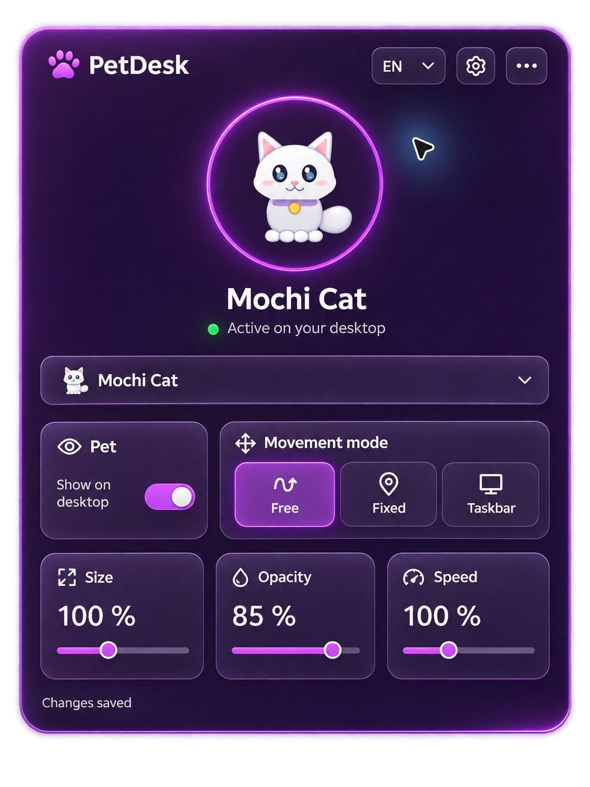

# PetDesk 1.1

[Русский](README.ru.md)

[](https://github.com/eturchin/PetDesk/actions/workflows/build.yml)

An offline animated desktop companion for Windows, with a compact glass dashboard in the system tray. No account, server, browser runtime or AI API is required.

<p align="center">
  
</p>

[Five palettes and settings](docs/screenshots/settings-en.jpg) · [Russian dashboard](docs/screenshots/dashboard-ru.jpg)

## Install and run

Download installer/portable artifacts from a successful [GitHub Actions run](https://github.com/eturchin/PetDesk/actions/workflows/build.yml), or build them locally. No tagged release has been published yet.

Run `PetDesk-Setup-1.1.0-win-x64.exe`. It installs for the current user under `%LocalAppData%\Programs\PetDesk`, creates a Start menu entry and offers an optional desktop shortcut. Administrator rights and a separate .NET Runtime installation are not required.

For portable use, extract **all** files from `PetDesk-Portable-1.1.0-win-x64.zip` and run `PetDesk.exe`. Keep its runtime and assets next to the executable. Requires Windows 11 x64.

Builds are not code-signed. Windows SmartScreen may identify an unknown publisher; do not disable Windows protections. `SHA256SUMS.txt` provides checksums for the installer and ZIP.

## A companion, a small dashboard

- Click the tray paw to open the dashboard. An outside click or Escape dismisses it.
- Drag the pet with the left mouse button; right-click it to open the panel.
- Use the cards for visibility, free/fixed/taskbar movement, size, opacity and speed. Changes apply immediately; disk saves are debounced.
- The gear opens settings inside the same panel. The overflow menu opens the app folder, About or Exit.
- Switch RU/EN in the header without restarting.

The preview displays the selected pet's real frames from the existing player. It does not run a second animation engine. A hidden dashboard has no independent rendering loop.

## Pets and import

**Mochi Cat** and **Pixel Fox** are original built-in pets, each with idle and left/right walking animations. The pet dropdown includes thumbnails and an Add pet item. Settings provide file/folder import, library browsing and confirmed deletion of imported copies. Built-in resources cannot be deleted.

PNG is supported directly. Known Codex layouts include 1536×1872 and 1536×2288 with 192×208 cells; other layouts use a schema-1 `pet.json`. WebP requires a compatible Windows WIC codec. See the [pet format](docs/pet-format.md).

Imports copy files and keep originals intact. Existing imported pets/settings remain compatible. User artwork and libraries are never bundled in repository or build artifacts.

## Make it yours

Choose **Amethyst**, **Ocean**, **Emerald**, **Rose** or **Amber**, with light/dark variants or system appearance. The custom editor validates five HEX colors, provides a live preview and saves a named palette only when requested. Built-in presets are protected, and appearance can be reset.

Windows startup is opt-in. Settings also provide hidden startup, position restoration and a visible-screen position reset.

## Data and uninstall

Settings, imported pets, themes and logs live under `%LocalAppData%\PetDesk`. Atomic settings saves keep a backup and recover damaged configuration.

Uninstall through Windows Installed apps. The uninstaller requests a clean shutdown, removes its own startup registration, installed files and shortcuts, and **preserves user data**. Updates use the same installation identity and keep the existing library.

## Build locally

Use .NET SDK 10 / C# 14. The installer additionally requires Inno Setup 6.7+.

```powershell
./tools/Build.ps1
./tools/Package-Release.ps1
```

Artifacts are written to `artifacts/Releases/1.1.0`: a self-contained x64 installer, portable ZIP and SHA-256 checksums. An existing package cache can be selected using `-PackageCache` and `-Offline`.

The build scripts resolve paths from the repository root. Inno Setup is detected from PATH or its standard installation directory; a custom compiler can be supplied with `-ISCCPath`.

See [development](docs/development.md), [packaging and CI](docs/release.md), [architecture](docs/architecture.md) and [validation limits](docs/validation.md). Tests generate their own synthetic atlas and do not require private assets or files from the author's computer.

## License

Code and original Mochi Cat / Pixel Fox artwork use [MIT](LICENSE). Imported images retain their own rights; see [NOTICE.md](NOTICE.md) and [third-party notices](THIRD-PARTY-NOTICES.md).
