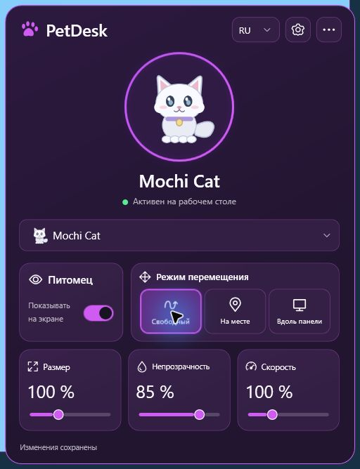

# PetDesk 1.1

[English](README.md)

[](https://github.com/eturchin/PetDesk/actions/workflows/build.yml)

Локальный анимированный питомец поверх рабочего стола Windows и компактная панель управления в системном трее. Приложение работает без аккаунта, сервера и подключения к сети.



[Палитры и настройки](docs/screenshots/settings-en.jpg) · [Панель на английском](docs/screenshots/dashboard-en.jpg)

## Установка и запуск

Установщик и portable-архив доступны в артефактах успешного [запуска GitHub Actions](https://github.com/eturchin/PetDesk/actions/workflows/build.yml). Их также можно собрать локально. Релиз с тегом пока не публиковался.

Откройте `PetDesk-Setup-1.1.0-win-x64.exe`. Установка выполняется для текущего пользователя в `%LocalAppData%\Programs\PetDesk`, без прав администратора. Ярлык в меню «Пуск» создаётся автоматически, на рабочем столе — по вашему выбору. .NET Runtime включён.

Для portable-варианта распакуйте `PetDesk-Portable-1.1.0-win-x64.zip` целиком и запустите `PetDesk.exe`. Не переносите exe отдельно от остальных файлов. Системные требования: Windows 11 x64.

Сборки не подписаны сертификатом издателя. Windows SmartScreen может показать предупреждение о неизвестном издателе; не отключайте защиту Windows. Контрольные суммы находятся в `SHA256SUMS.txt`.

## Управление

- Нажмите иконку лапки в трее, чтобы открыть Dashboard. Клик вне панели или Escape скрывает её.
- Перетаскивайте питомца левой кнопкой мыши. Правый клик по нему открывает панель.
- Карточки управляют видимостью, режимом движения, размером, непрозрачностью и скоростью. Изменения применяются сразу и сохраняются с задержкой, без записи на каждый пиксель слайдера.
- Шестерёнка открывает настройки внутри панели. Троеточие — папку приложения, сведения и полный выход.
- RU/EN переключаются в заголовке без перезапуска.

## Питомцы и импорт

Mochi Cat и Pixel Fox — оригинальные встроенные персонажи с idle и движением в обе стороны. Выберите питомца в dropdown, последний пункт — «Добавить питомца». В настройках доступны импорт файла/папки, открытие библиотеки и удаление импортированной копии после подтверждения. Встроенные ресурсы защищены от удаления.

Поддерживаются PNG, известные Codex-сетки 1536×1872 / 1536×2288 и произвольные сетки через schema-1 `pet.json`. WebP требует совместимого Windows WIC-кодека. См. [формат питомца](docs/pet-format.md).

Оригиналы не изменяются и не удаляются. Ранее импортированные питомцы остаются в библиотеке. Пользовательские изображения и библиотеки не включаются в репозиторий и сборки.

## Оформление

Встроены Amethyst, Ocean, Emerald, Rose и Amber, со светлыми/тёмными вариантами и режимом «Как в Windows». Своя палитра содержит пять HEX-цветов и название. Редактор показывает live preview, проверяет значения и сохраняет палитру только по вашей команде. Встроенные палитры не удаляются; оформление можно сбросить.

## Windows и данные

Автозапуск включается только вашим флажком в настройках. Можно выбрать скрытый старт, восстановление позиции и сброс положения на видимый экран.

Данные находятся в `%LocalAppData%\PetDesk`: настройки с резервной копией, `Pets`, `Themes` и журналы. Схема прежних настроек совместима. Удаление через «Установленные приложения» закрывает PetDesk, убирает принадлежащий ему автозапуск и удаляет программу/ярлыки. Настройки и импортированные питомцы сохраняются.

## Сборка

Нужен SDK .NET 10 с C# 14. Inno Setup 6.7+ нужен для установщика.

```powershell
./tools/Build.ps1
./tools/Package-Release.ps1
```

Готовые файлы записываются в `artifacts/Releases/1.1.0`. Скрипты вычисляют пути относительно проекта, а Inno Setup находят в PATH или стандартной папке установки. Для другого расположения компилятора есть параметр `-ISCCPath`.

Подробности: [разработка](docs/development.md), [сборка и CI](docs/release.md), [архитектура](docs/architecture.md), [проверки и ограничения](docs/validation.md). Тесты генерируют собственный атлас и не требуют приватных изображений.

Код и оригинальные ресурсы — [MIT](LICENSE). Права на импортированные изображения описаны в [NOTICE.md](NOTICE.md).
